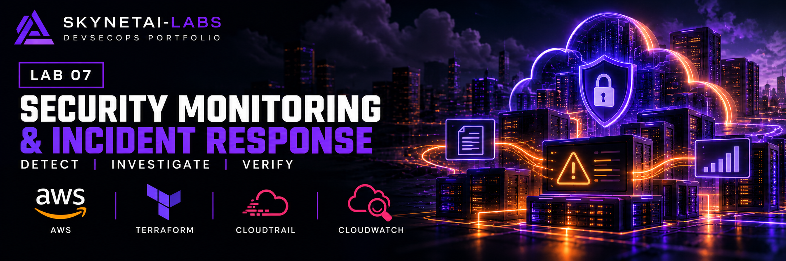

# GitHub DevSecOps Lab 07 — Security Monitoring and Incident Response

A practical AWS learning lab demonstrating a denied API request,
security-event investigation and verified alarm delivery.

**Status:** Live testing completed. All 19 Terraform resources destroyed;
independent AWS API checks confirmed removal. Ten static findings remain
open and unsuppressed. GitHub Actions failed on the ten documented Checkov findings.

## Architecture

CloudTrail regional management events feed:
- A private S3 bucket with AES256 encryption, public-access blocking,
  versioning and lifecycle rules.
- A CloudWatch Logs group with one-day retention.

A CloudWatch Logs metric filter detects denied API calls. A standard
CloudWatch alarm sends state-change notifications through SNS to an
SQS queue using SQS-managed encryption.

Two dedicated IAM roles support log delivery and authorised simulation.
The simulation role trusts the existing operator role and explicitly
denies ec2:DescribeInstances.

## Verified Live Results

| Test | Observed result |
|---|---|
| Terraform deployment | 19 added, 0 changed, 0 destroyed |
| Restricted-role request | DescribeInstances denied |
| Event correlation | Exact request ID, role and session matched |
| CloudTrail event | Read-only; Client.UnauthorizedOperation |
| Detection | Alarm changed from OK to ALARM |
| Observed detection time | 48.926 seconds from request start |
| Notification action | CloudWatch reported successful SNS action |
| Alert delivery | Corresponding ALARM message retrieved from SQS |
| Log delivery | Trail status reported S3 and CloudWatch delivery |
| Digest delivery | Reported by trail status; chain not validated |
| Evidence backup | 9 S3 object versions backed up; hashes verified |
| Data cleanup | 9 versions deleted; none remained at verification |
| Infrastructure cleanup | All 19 Terraform resources destroyed |
| Independent checks | Bucket, trail, roles, topic, queue, log group and alarm absent |

The latency is one observation, not a service guarantee.
The detection rule matches general denied API calls, not only this test.
The queue receipt identifies the alarm transition; it does not contain
the original CloudTrail request ID.

## Static Security Results

Checkov 3.3.30 scanned the Terraform source:
**54 passed, 10 failed, 0 skipped.**

Open findings cover SNS encryption, CloudWatch retention and KMS,
CloudTrail delivery notifications, KMS and regional coverage,
and S3 event notifications, access logging, KMS and replication.

See [Security findings](docs/security-findings.md).
No findings were suppressed.

## Evidence and Investigation

- [Verified results](docs/evidence/verified-results.json)
- [Incident report](docs/incident-report.md)
- [Security findings and limitations](docs/security-findings.md)

The simulation used one denied read-only request. The explicit deny
was a preventive control configured before the event.
No automated containment or session revocation was demonstrated.

The published JSON is a selected, sanitised summary of the historical test.
It supports request-ID/role correlation, alarm and queue timestamps, and
recorded cleanup outcomes. Full raw logs, backup hashes and AWS API responses
are held privately; this repository review did not independently re-run the
live test or inspect those private originals.

Selected evidence is published. Raw logs, account details, Terraform
state, plans and private backups are excluded from Git.

## GitHub Actions

The workflow performs:
1. Terraform formatting checks.
2. Initialization without backend and with the committed provider lock.
3. Terraform validation.
4. Checkov 3.3.30 Terraform scanning.

It has read-only repository permission and no AWS credentials.
It contains no deployment or destruction steps.

**Verified CI result:** Checkov reported 54 passed, 10 failed and 0 skipped, then exited with code 1. The workflow failed on these unsuppressed findings.

[Historical workflow run](https://github.com/SkynetAI-Labs/lab-07-security-monitoring-response/actions/runs/39696629214) — tested commit `630c081`.

[Latest reviewed workflow run](https://github.com/SkynetAI-Labs/lab-07-security-monitoring-response/actions/runs/39992265407)
completed on 23 October 2026 for commit
`94ba90a5bd877db960645af1dc5ee64efff8ca55`.
Formatting, backend-free initialisation and Terraform validation passed.
Checkov again returned 54 passed, 10 failed, 0 skipped; the workflow failed.

## Scope and Limitations

- Temporary learning environment in eu-north-1, not production work.
- No multi-region or global-service event coverage.
- No data events, CloudTrail Insights, KMS management events or
  RDS Data API management events configured.
- No email-delivery or human-acknowledgement test.
- Missing metric data is treated as non-breaching; an OK state
  alone does not demonstrate pipeline health.
- No cryptographic digest-chain validation.
- No production retention or disaster-recovery design.
- Local scan results are separate from live test evidence and CI results.
- Actual billed cost has not been verified.

## Reproduction Notes

Terraform: 1.16.6. AWS provider: 6.69.1. Checkov: 3.3.30.

The configuration expects an existing IAM role named AccountFullAccessRole.
Its ARN is resolved by a data source; that role is not created or modified
by this project. Adapt the trust principal for another environment.

Review permissions, current pricing and a Terraform plan before deploying.
Cloud services can incur ongoing usage charges while resources remain.
The deployment was removed after testing; do not redeploy merely to
inspect this portfolio evidence.

For cleanup, stop logging, preserve evidence, verify and remove all S3
object versions and delete markers, then destroy the Terraform resources.
Lifecycle expiry alone is not immediate cleanup.
Current S3 objects expire after seven days; noncurrent versions become
eligible for permanent deletion after one day noncurrent. Overwrites and
manual deletions can start that second clock earlier. CloudWatch retains
events for one day and SQS retains messages for 86,400 seconds. These short
lab periods require prompt evidence export; none is an immutable retention
or production retention policy.

Historical CloudWatch metric data may remain under AWS retention after
the metric filter is removed; the independent checks above establish
absence of the specified lab resources, not erasure of AWS service history.

## Repository audit — 24 October 2026

See the [dated security audit and prioritised recommendations](SECURITY_AUDIT.md) for the reviewed source commit, verification results, open findings and evidence limitations.

